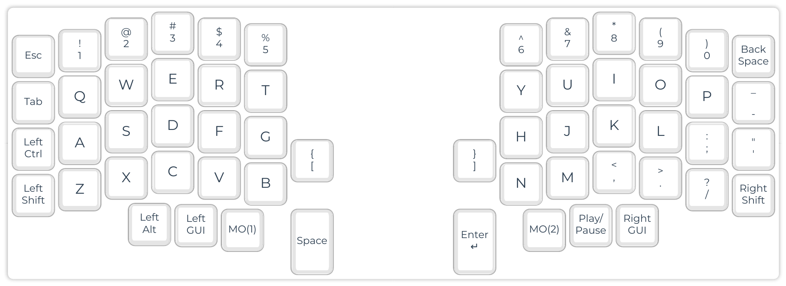
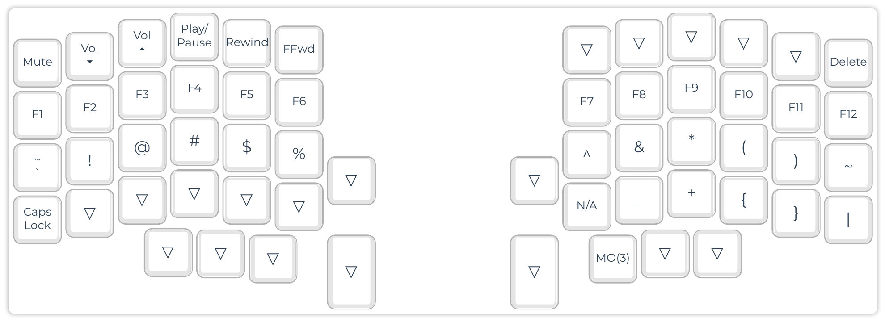
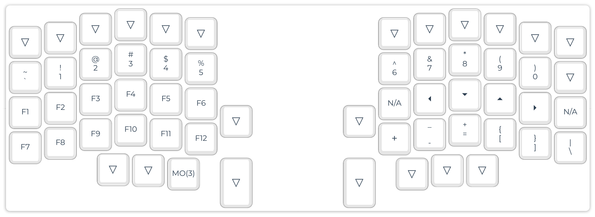
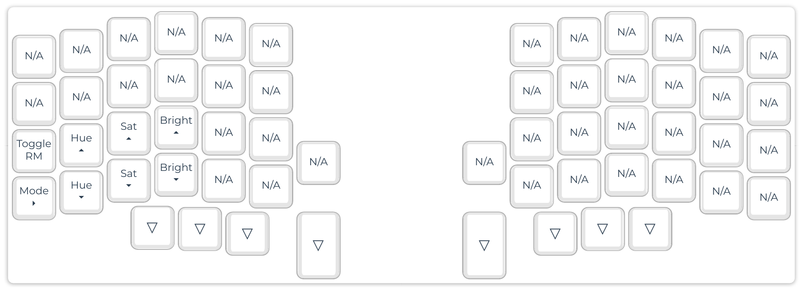

# Lily58 Pro QMK

My QMK keymap for the Lily58 Pro (`mechboards/lily58/pro`). 

## Base



## Lower



## Raise



## Adjust



## Install

Copy `keymap.c` and `config.h` into a new keymap folder in your QMK folder, then flash each half separately:

```
mkdir -p ~/qmk_firmware/keyboards/mechboards/lily58/pro/keymaps/mine
cp keymap.c config.h ~/qmk_firmware/keyboards/mechboards/lily58/pro/keymaps/mine/
cd ~/qmk_firmware
qmk flash -kb mechboards/lily58/pro -km mine -bl avrdude-split-left
qmk flash -kb mechboards/lily58/pro -km mine -bl avrdude-split-right
```

`layout.json` is a Configurator export, so you can import it at [config.qmk.fm](https://config.qmk.fm) to edit the layout visually.
